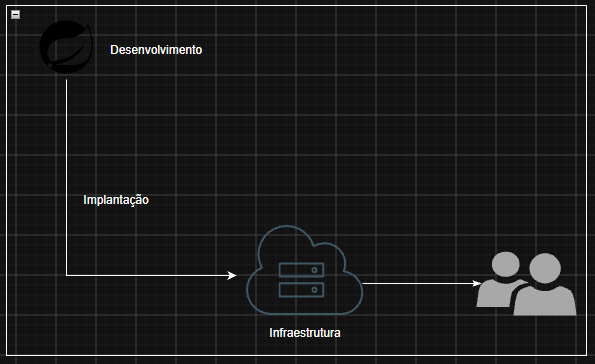
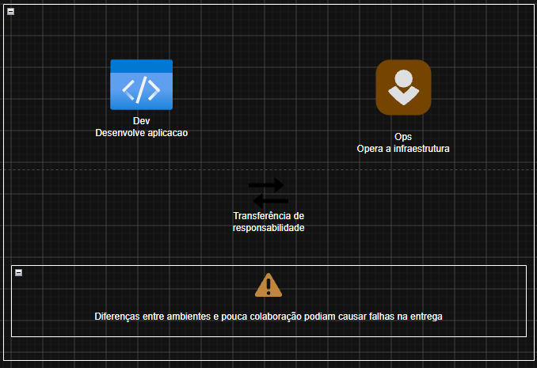
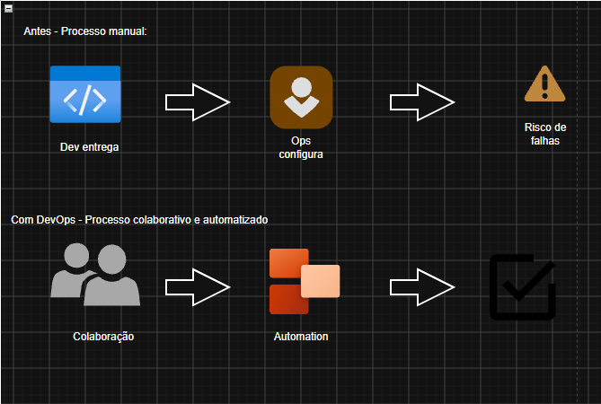
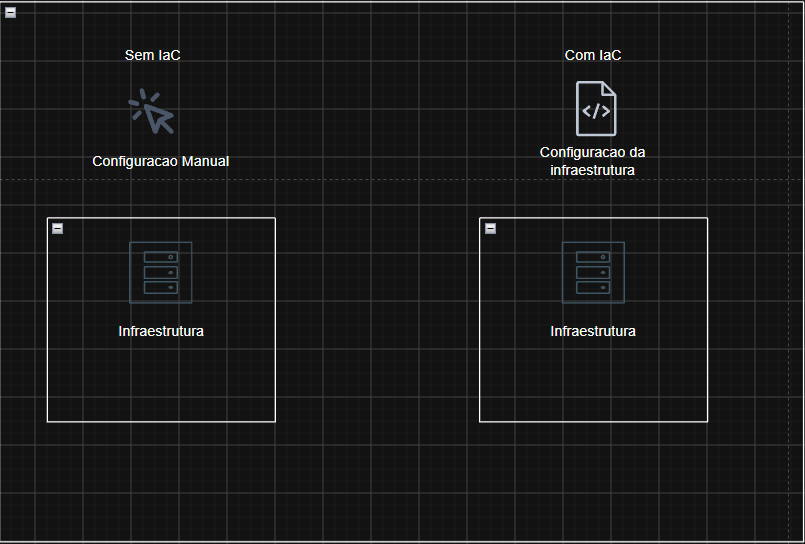

## Aula 1 - Por que Terraform?

1. O software precisa ser entregue:
Um software não esta concluido simplesmente porque funciona no computador do desenvolvedor. Ele precisa estar disponivel para os usuarios

Agora, imagina voce que desenvolveu um projeto que possue API Java com Spring Boot, e ela compila, passa nos testes e funciona perfeitamente no seu notebook

E a pergunta: será que isso significa que a aplicação está pronta para ser utilizada por milhares de usuários?

Não necessariamente, pois para disponibilizar, precisa considerar a infraestrutura responsavel por executar a aplicacao, garantir disponibilidade, lidar com aumentos de trafego e proteger o sistema

Ou seja, isso seria o Software Delivery!

2. A separacao entre Dev e Ops

Antigamente, as empresas costumavam dividir o desenvolvimento e a operacao dos sistemas em duas equipes:

> Dev era responsavel por desenvolver o software, escrever codigo e implementar funcionalidades

> Ops era responsavel por preparar servidores, configurar ambientes e manter as aplicacoes funcionando

E qual era o problema disso? 
A separacao entre equipes dificultava a entrega de software, causando incosistencias, falhas e atrasos na implantacao

3. O surgimento do DevOps

Como as empresas cresceram, e essas separacao causava dificuldades, ocorrendo implantacoes lentas, configuracoes inconsistentes e falhas frequentes. 
O movimento DevOps surgiu para aproximar a responsabilidades e tornar a entrega de software mais eficiente!

Lembrando: DevOps nao e linguagem de programacao, ou cargo especifico, ele e um conjunto de práticas, processos e princípios voltados à colaboração e à melhoria da entrega de software
> Yevgeniy Brikman resume seu objetivo como tornar a entrega de software muito mais eficiente

4. O que muda com DevOps?

Agora imagina uma empresa que precisa publicar uma nova versao de uma API Java:

DevOps procura tornar as entregas mais frequentes, previsiveis e seguras. Mas isso nao elimina todos os erros, mas ajuda a reduzir problemas associados a processos manuais

5. Os quatros valores do DevOps - CAMS

O autor apresenta quatros valores centrais do movimento DevOps

Valor:
C - Culture > Cultura de colaboracao
A - Automation > Automatizacao
M - Measurement > medicao de resultados
S - Sharing > Compartilhamento de conhecimento

A automacao é uma das bases da IaC

6. O que é Infrastructure as Code (IaC)?

Na etapa anterior, aprendemos que a automacao e um dos valores fundamentais do DevOps
E agora surge uma pergunta: como podemos automatizar a criacao e a administracao de servidores, redes e bancos de dados? 
Aqui que entra o conceito de Infrastructure as Code(IAC) 

IaC > consiste em utilizar codigo para definir, implantar, atualizar e destruir infraestrutura

Como isso funciona? 

Vamos imaginar uma empresa que precisa preparar uma Infra na AWS para executar API Java
Sem IaC, um profissional poderia acessar o console AWS e configurar manualmente:
Uma instância EC2 para executar a aplicação
Uma VPC para organizar a rede
Um banco de dados para armazenar informações

Com IaC, essas configuracoes podem ser descritas em arquivos de codigo e processadas por ferramentas especializadas

Uma mudanca de mentalidade

É passar a tratar a infraestrutura como software
> isso significa que as configuracoes podem ser armazenadas em arquivos, organizadas, revisadas e controladas por ferramentas de versionamento, como o Git

Iac > nao e uma ferramenta especifica
Terraform é uma ferramenta que implementa o conceito de Infrastructure as Code

7. O que sao Ad Hoc Scripts? 

o termo significa algo desenvolvido para uma finalidade especifica
Na infraestrutura, sao scripts escritos em linguagens como Bash, Python ou Ruby para automatizar tarefas que normalmente seriam executadas manualmente

E como funcionam? 

Vamos imaginar que voce precisa configurar um servidor Linuz para executar aplicacao web
Em vez ser manual, pode reuni-los em um arquivo .sh

Vou colocar um exemplo:
O livro apresenta um exemplo chamado setup-webserver.sh, que utiliza comandos para instalar PHP e Apache, baixar o codigo de uma aplicacao e iniciar

Executar script Bash 
↓
Atualizar pacotes
↓
Instalar PHP e Apache
↓
Servidor configurado

Qual e a vantagem?
A simplicidade
Qual e a desvantagem?
liberdade dos scripts pode se tornar um problema

